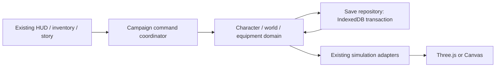

# VESPER persistent ARPG conversion specification

**Proposal for owner approval — 2026-10-28. No gameplay or save code implemented.**
Read [AUDIT.md](AUDIT.md) for verified source/baselines and
[ROADMAP.md](ROADMAP.md) for six separately reviewable phases. This document is
an engineering recommendation; numeric balance and policy choices below are
**proposed defaults**, not historical decisions or already approved gameplay.

## 1. Product contract and boundaries

Evolve the existing single-player gothic game into a permanent character/campaign.
Death, refresh, closure and campaign completion must never intentionally erase
levels, earned XP, owned items/mods, ash, allocations or quest/unlock progress.
Save/Continue becomes the normal lifecycle. New Character never silently replaces
an existing one. Initial scope: one local character slot, character-owned stash,
o account/backend/cloud sync, multiplayer, classes, external assets or purchases.

Diablo, Grim Dawn and Path of Exile inspire persistent builds, revisitable areas
and distinct loot choices. VESPER retains its original world, art, story and item
content. Preserve combat/collision, eight archetypes, bosses, inventory/loadouts,
three abilities, pause/input, graphics v2, Canvas and app-shell offline support.
ARPG lifecycle changes below are explicit exceptions to the old run rules.

### Approaches considered

| Approach | Tradeoff | Recommendation |
| --- | --- | --- |
| JSON in localStorage | Simple, synchronous; small quotas; awkward cross-record atomicity/backups and large world data | Retain only small existing preferences/legacy source, not character authority |
| IndexedDB domain snapshot + revisioned transactions | Offline, asynchronous, atomic same-DB transactions; needs strict validation, failure UX and browser tests | **Recommended**, no dependencies |
| Full live engine serialization/event sourcing | Replays every combat timer/entity; large migration surface and object references; event logs can grow unbounded | Do not serialize renderer/AI or introduce an unrelated engine |

Recommended save model is a bounded aggregate snapshot plus durable command/reward
IDs, not an unbounded event log. Character and its campaign/area manifests live in
one atomic revision. Rendering remains a consumer of reconstructed runtime data.
The owner has not yet selected/approved these options; approval is the next gate.

## 2. Integration gate G0

Gate G0 is satisfied: the owner tested and merged graphics integration PR #28.
Pinned main is `17c8fadea6f881245384cec92fd14417b4a998c1`; reviewed graphics
head `1c4b4e9` is an ancestor and the runtime tree matches that reviewed stack.
See AUDIT.md for original stack targets and integration evidence. This spec branch
now incorporates that main and preserves its graphics work. Recheck upstream and
open PRs before creating implementation branches. Specification/balance approval
is still pending; this documentation authorises no gameplay implementation,
merge, deployment or code cherry-picking.

## 3. State ownership and proposed modules



Proposed modules (none exists yet):

- `character-state.js`: DTO validation, permanent stats/XP and allocation budgets,
  legacy adapters and pure migrations. CommonJS/window API as existing modules.
- `save-store.js`: IndexedDB open/upgrade, revisions, backups, writer lease,
  recovery, import/export; injected clock/ID factory/storage adapter for tests.
- `campaign-state.js`: area manifests, checkpoint/unlock/quest transitions,
  boss/reward ledgers, explicit replay instances; no DOM or renderer.
- `campaign-controller.js`: bridges existing index.html/inventory/narrative/boss
  adapters to commands, save status and transition/pause coordination.
- Small `sanctuary-content.js` only in the hub phase: original NPC/interaction
  definitions and a supported playable hub world, not a separate UI-only game.
- Extend equipment.js minimally with validated item hydration and allocator
  high-water reservation; reuse existing E.valid, swaps, mods and stats.

Keep index.html's movement, hurt, resolveMelee and render data contract. Hydrate
fresh runtime objects, rebuild flow/meshes and update world identity on area load;
never let saved records retain Three.js objects, functions, DOM nodes or live AI.
No changes to art/material/shader files for persistence. Renderer changes only if
the approved hub needs an explicit world theme, preserving existing dungeon themes.

## 4. Versioned save schema (proposed version 1)

IndexedDB database `vesper-arpg`, initial **DB version 1**. Separate domain
`schemaVersion` from IndexedDB's structural version and from generator/content/
progression rules. Saved records use allowlisted plain fields, arrays, bounded
strings and finite numbers. No arbitrary object spread from imported data.
Proposed safety bounds: layouts <=256x256, <=128 rooms/instance, <=1024 spawn or
chest records/instance, <=4096 item records/character, <=6 retained dungeon instances (five campaign plus one replay),
256 recovery equipment slots, and bounded journal/flag strings. Sanctuary uses
a versioned static layout plus saved NPC/checkpoint flags, outside the dungeon
instance count; its current location ID still persists. These exceed current
world sizes but must be tested on mobile; exceeding them refuses the candidate or
command without discarding data. Revisit limits via explicit versioned changes.

Store a `SaveEnvelope` in `characters`, keyed by characterId:

```text
schemaVersion: 1
contentVersion: 'campaign-1'
progressionVersion: 1
characterId: UUID (injected deterministic factory in tests)
revision: safe integer >= 1
createdAt, savedAt: informational UTC timestamps (never drive combat)
writer: {sessionId, leaseEpoch}
integrity: {algorithm: 'SHA-256', digest: canonicalPayloadDigest}
payload: {
  character: {
    level, lifetimeXp, xpIntoLevel, unspentSkillPoints,
    coreProfile: 'penitent-v1', passiveRanks: {}, abilityUpgradeRanks: {},
    resources: {hp, equipmentShield, potions},
    timers: {abilityCooldowns: {execution,aegis,stunning},
             attackRemaining, dodgeRemaining, firePassiveRemaining, shieldDelay},
    ash, deaths,
    equipment: {main: itemId|null, off: itemId|null},
    backpack: [itemId|null] (exactly 6),
    stash: [itemId|null] (proposed 24),
    nextItemId: positive safe integer,
    abilityUnlocks: ['execution','aegis','stunning']
  },
  items: [{id: positive safe integer, key: existing item key,
           mods: [{stat,value}], upgradeRank: 0..3}],
  campaign: {
    unlockedLocations: ['forgotten-crypt'], activeCheckpointId,
    campaignComplete: false, bossCompletions: {}, eliteCompletions: {},
    questStates: {}, storyFlags: [], journalEntries: [], rewardLedger: {}
  },
  world: {
    lifecycle: {mode: 'alive', deathId: null, lastRespawnId: null},
    currentLocationId, currentInstanceId, pendingTransition: null,
    checkpoints: {}, locations: {}, instances: {}
  },
  legacy: {migrationId, bestKills, narrativeMemories, sourceFingerprint}
}
```

`items` is a canonical ownership table, not a second backpack. Every item ID must
have **exactly one owner reference**: main, off, bag, stash, one ground drop, or
reward escrow. Two-hand gear is referenced only by main; off stays null and the UI
shows occupied, exactly as now. Runtime E.* still receives frozen `{id,key,mods}`
objects; save references hydrate to those objects. `upgradeRank` is optional future
metadata with rank 0 until Phase 5; do not rewrite or overload the existing mods.

Each `world.instances[instanceId]` includes:

- locationId, mode (`campaign` or `replay`), instanceId, visit/reset epoch, encounter-attempt counters;
- generatorVersion, initial seed, PRNG algorithm/version and saved RNG state;
- authoritative bounded layout descriptor (width/height, walk grid, room/start/
  exit descriptors, layout hash), stable spawn/chest/encounter IDs and spawn specs;
- defeated stable spawn IDs, opened chest IDs, trap definitions, exploration;
- ground drops with stable dropId, itemId or ash/potion amount, position and origin
  rewardId; quest object state; encounter completion/reward escrow references.

Seeds alone are insufficient: code changes and shared random draws can otherwise
move chests/enemies and invalidate references. Reconstruct functions/typed arrays
from a validated descriptor. Persist concrete remaining spawn specs/outcomes;
cosmetic phases may be recomputed. Version/content migration must not regenerate
layout underneath saved item positions. Cache at most one campaign manifest per
floor plus one active optional replay; retired cleared encounters may compact to
ledgers. Never discard ground equipment during compaction/reset; transfer to a
bounded-page recovery cache in Sanctuary or refuse the reset if capacity fails.

Persist intrinsic stats as a versioned core profile + level + allocations and
upgrade ranks, and derive actual runtime maxHp/damage/speed/range/arc/crit each
load. Store an optional verified derived-stat snapshot for diagnostics only.
Never add gear totals back into base stats. Validate any snapshot against the
versioned rules. Preserve current health/shield amounts clamped to derived maxima;
no shield/cooldown refresh by loading, swapping or opening inventory.

### Validation and identity invariants

- Explicit schema/content version support; unknown future versions are **read-only
  unsupported**, not a reason to start over or overwrite them.
- Validate safe integer IDs/revisions/XP/currency, bounded records, exact slot
  lengths, allowed enums/keys and finite numeric ranges. Initial import limit
  proposed 5 MiB; enforce decoded dimensions/count limits before allocations.
- E.validModifiers must accept the exact existing mods; do not reroll, clamp away
  or silently delete invalid imported gear. Reject/quarantine the whole candidate
  and offer recovery. Detect duplicate IDs, dangling refs, orphan items, two-hand/
  off-hand violations and duplicate ownership **across all world/stash/escrow**.
- Numeric item IDs remain compatible with current APIs. nextItemId exceeds every
  allocated item, including ground/escrow. Hydration must reserve the allocator at
  the durable high-water mark **before** any call can generate another item.
  Do not call E.item on load and accidentally assign replacement IDs.
- CharacterId namespaces items across exports. Initial stash is character-local;
  cross-character transfers/multiple slots are future work, not accidental support.
- Points spent + unspent equals points earned under versioned rules. Unlocks,
  quests, completions and one-time reward states must be mutually consistent.
- Validate before and after each pure migration; validate and freeze hydrated
  equipment; an invalid candidate never partially modifies the live character.

## 5. Durability, concurrency and recovery

Object stores in the **same DB**: `characters` (latest aggregate), `backups`
(characterId/revision snapshots), `meta` (active slot, migration marker, content
compatibility) and `leases`. Single readwrite transaction compares expected revision
and lease epoch, writes candidate + prior-good backup + metadata, then commits.
Publish live state/green Saved indicator only after transaction completion, not
individual request success. Optional strict durability is feature-detected; never
promise fsync on every device. Compute checksums before opening the write transaction; do not await crypto or
network inside an active IDB transaction. No localStorage mirror as a second authority.

Retain at least previous three validated revisions plus a pinned pre-migration
backup, proposed five rotating backups total (pinned backup excluded). Prune only
within a successful transaction; quota failure keeps current data. Backups in the
same origin protect corruption/migration, **not** eviction or device loss.

A single command queue serializes character mutations. A DB writer lease with
expiry/heartbeat and fencing epoch plus revision checks is authoritative. Web
Locks/BroadcastChannel are optional optimizations/notifications, not requirements.
A second tab is read-only. A stale tab cannot commit after a lease takeover; it
must reload or export its unsaved state. IndexedDB versionchange closes obsolete
connections; blocked upgrades show a close-other-tab message, not endless loading.

Critical commands (create/import, equip/unequip, pickup/drop, potion use, ability
activation/cooldown reservation, stash transfer,
reward claim, upgrades/points, level grants, quest completion, checkpoint/death,
area travel) use a draft, existing domain validation and a durable transaction.
Do not publish partial success or allow a second tap while pending. Preserve
existing simulation pause reasons and release only the save command's own pause.
Potion use commits the inventory decrement and resulting HP together before
publishing the heal. Ability activation commits its fixed cooldown reservation
before starting the existing cast/effect; an interrupted pending activation cannot
cast twice or bypass cooldown on reload. Do not save every held movement input or
normal attack frame. Measure activation latency on mobile; preserve wind-up/damage
timing relative to the committed activation and show pending input explicitly.
No UI/input handler awaits storage inside requestAnimationFrame or mutates DOM from
pure simulation modules. Reward generation is staged once and committed with its
reward marker and item/escrow; retry cannot reroll or grant twice.

Movement/HP/exploration/combat snapshots are coalesced (proposed <=1 s dirty window
while active). Periodic autosave is additional to event commits, not a full JSON
stringify every frame. Cooldowns use simulation seconds; savedAt does not advance
them. Critical reward/loot commits must include the matching enemy/chest/event
ledger, XP/currency, resolved item outcomes and allocated IDs in one revision.
Gameplay resumes after commit. Capture event IDs synchronously to prevent duplicate
kills while a save is pending; defer visual finalization safely through adapters.

Death stages HP=0/death record and durable checkpoint intent; no loot/currency/XP
rollback. If commit fails, keep the in-memory character and pause with Retry save /
Export unsaved state / Return to recovery; never invoke startGame or pretend saved.
Canonical stored HP is >=0; record `dead-pending-respawn` and a stable deathId
with the death command. On load HP=0/dead status executes idempotent respawn, not a fresh character.

On hidden/pagehide, clear input, cancel casts, pause simulation, request a dirty
flush and suspend writers. **Mobile OS kills may run no handler; an async exit
save is not guaranteed.** Continue restores the last committed revision, so the
last <=1 s noncritical combat/movement/resource-damage snapshot may be lost; acknowledged critical
items/rewards must survive. IndexedDB completion itself is the app-level boundary,
not a guarantee against hardware failure. Show Saving/Saved/Unsaved failure states.
If storage is denied/full, do not offer a fake persistent session; permit only an
explicitly labelled unsaved trial with export, outside the normal Continue path.

At boot read metadata/version without generating a new character, acquire lease,
validate newest snapshot, and use explicit recovery when invalid. Keep corrupt
bytes for export/debugging; validate backups newest-first and show revision/date/
progress differences before owner chooses restore. Never overwrite all slots with
create defaults. Migrations are pure N→N+1 (e.g. v1→v2 in future), atomic and
idempotent, with pre-migration backup; do not fabricate historical v0 saves.

Minimal validated emergency export (including unsaved in-memory state) and backup
selection are required before enabling persistence in Phase 2. Full portable
export/import management is recommended in Phase 6: versioned JSON envelope with
checksum for accidental corruption (not an anti-cheat signature), bounded parsing,
validation, preview and explicit replace confirmation. Import replaces the selected
character atomically with backup; never merge item lists/reward ledgers. Restore
may roll back to a chosen revision but cannot append its items to the current one.
Offline single-player data remains user-editable; preventing local tampering,
manual backup replay or browser data deletion absolutely is impossible without a
trusted server and is not a promised feature.

Origin matters: production, preview URLs, Safari and installed PWAs may not share
storage. Test actual iOS behaviour; do not assume cross-origin persistence. Request
persistent storage where supported and explain refusal/eviction risk; export is
how the owner moves data between origins/devices. Cache clearing must not delete
IndexedDB; browser site-data removal can delete both. Old application versions
must refuse writing newer schema/content saves. A save-aware update flow prompts
at a safe point, flushes, then activates the compatible worker and reloads; do not
allow mixed old/new JS to migrate/write a newer save. Coordinate service-worker
skipWaiting/clients.claim changes as a dedicated tested integration patch.

## 6. Campaign, revisits and Sanctuary (proposed rules)

Initial campaign remains Forgotten Crypt → Plague Halls → Crimson Chapel → Hollow
Sanctum → Throne of Ash. Unlocks are permanent. Initially Crypt entrance is the
safe checkpoint; Sanctuary is unlocked after the first Crypt completion and is
always accessible thereafter through an unlocked shrine. A pre-campaign hub instead
is an owner option, not silently added narrative. Travel is menu/tap based at safe
shrine locations, not anywhere during combat; keyboard mapping chosen after input
conflict audit. Existing movement/attack/ability controls retain positions.

Sanctuary is a small **playable 3D world** using existing geometry and collision,
plus Canvas fallback. Include stash, management/blacksmith interaction and a
Forgotten Knight presence with original short dialogue; retain his Crypt presence.
Reserve merchant interaction IDs without implementing shops/classes or buying assets.
No damaging enemies/hazards in the hub. Use validated safe spawn/checkpoint markers
and accessible NPC positions; a hub theme is explicit, not floor index -1.

- Each campaign floor gets a seed/layout at first entry; revisits restore it and
  its durable chest/loot/quest/completion state. It is not automatically rerolled.
- Kills persist within an area instance; same-instance death/reload/revisit cannot
  award killed actors again. No timed/offline enemy respawn. Partially damaged
  living normal enemies reset HP/AI to initial spawn state on reload/death/revisit;
  their rewards were not granted, so no duplicate. First arrival on each unlocked
  floor records its safe entrance checkpoint before combat resumes, so Continue
  never references an inaccessible checkpoint from a different area. Persist player resources as above.
- An **explicit Rest and repopulate** at a shrine may create a new regular-encounter
  epoch. First move all remaining ground equipment to recovery storage atomically;
  refuse if it cannot be represented safely. Replenish ordinary enemies/chests with
  new epoch IDs, permitting intentional farming; keep campaign elites/bosses dead,
  unique rewards claimed, quests complete and access unlocked. No passive reload
  farming. Confirmation explains the reset; no free repeated floor-transition heal.
- First clearing a locked area still uses its kill quota, final encounter and
  authored quest gate. Persist seal unlock once earned; revisits never close it.
  On Floor 1 the crown must be collectible if the boss is dead but crown unclaimed:
  reconstruct its stable quest object, never require replaying boss-death events.
- Campaign bosses are permanently defeated for that character. Rewards are
  generated once using existing rarity tables, held as persistent ground equipment
  or encounter escrow, and claimed once. A full bag cannot discard the reward or
  reroll it. Elites retain existing non-boss reward behaviour (no invented guarantee).
- Persist completion **before** the skippable King victory cinematic; reload may
  skip/replay presentation safely but never undo completion/grant another reward.
  All five floors completed records campaignComplete and returns access to Sanctuary;
  it never starts over. Later floors have existing playable content, not invented
  authored quest chapters.
- Incomplete boss attempts reset boss HP, guards and King candles on death/reload/
  leaving; active acid/fire/axes/summons are transient and cleared. Already-awarded
  guard rewards remain suppressed by stable spawn/reward IDs on that retry. Guards
  can return as encounter defenders without farming XP/items. Keep their
  campaign reward ID stable while the durable encounter-attempt counter changes;
  a retried guard presentation must not create a fresh reward entitlement. Preserve attack logic,
  telegraphs, safe routes, candle ward and protected stun behaviours.
- Optional replay later creates a separate seeded instance namespace/ledger. Boss
  rewards there are once per replay encounter, not campaign unique rewards. Existing
  boss rarity weights remain. Replay never rewrites campaign flags; no new content
  assets or classes. It is opt-in and not the death/Continue route.

Reward keys: characterId + mode + instance/epoch + encounter/spawn/chest ID +
reward kind, with campaign-unique keys using location/quest IDs independent of
reset epochs. States: unearned → granted-in-escrow/ground → claimed, atomically.
On actor death, resolved reward + XP + killed marker commit together. Pickup moves
that item reference to bag, not a second generated item. Ash/potion drops have IDs
and claimed markers too. Minions remain rewardless in every mode.

## 7. Death, Continue and resource policy

Proposed no XP, item, ash or allocation loss; no corpse run, durability destruction,
permadeath or resurrection fees. Death returns to last unlocked safe checkpoint
at full HP; potions retain their current count (no infinite three-potion refill).
Equipment shield retains min(saved capacity, derived maximum), not a refill.
Temporary Aegis, harmful statuses, projectiles and pending attacks are discarded;
ability/dodge/fire cooldown remaining values survive death/refresh (no reset spam).
One second arrival protection follows the existing transition convention; it does
not stack and cannot be used for cross-area attacks. Recheck safe cell/collision,
not arbitrary imported player coordinates.

Continue after closure resumes at the safe checkpoint in the current area,
restoring last committed HP (full only if committed death respawn), potions,
equipment shield and cooldowns, along with that area's ledger. Do not resume
inside an unsafe boss mechanic or replay an in-flight hit. HP loss/position in the
last unsaved noncritical window is the documented crash limitation. Combat timers
freeze offline/background; no real-time heal/loot progression.

Keep existing +20% max-HP/one-potion forward transition recovery **once per first
campaign unlock transition**; record recovery claim with transition. Do not grant
it on repeat travel/reload. Proposed Sanctuary shrine heal: full HP, no potion or
shield refill; intentional safe hub healing, not an inventory exploit. Exact death/
shrine resource policy needs owner approval. Checkpoint activation itself does not
silently duplicate consumables or complete a quest.

Travel is an idempotent command with a transitionId: validate source safety and
unlocks, build/validate destination descriptor, commit destination/checkpoint,
recovery claim and source ledger, then publish runtime world. If crash happens
before commit, source remains; after commit, destination is authoritative. Any
pending travel marker must resolve to exactly one side; never grant recovery twice.

## 8. Permanent progression and equipment evolution

Proposed first balance: level cap 30, preserve the existing XP threshold recurrence
(start 48; next round(previous*1.24+16)), retain lifetime XP even at cap for future
migrations. No currency/XP loss on death. Level-derived base +5 HP and +1 damage
per level after 1; other starter core values initially unchanged. Level grants one
skill point (29 by cap), atomically and exactly once; XP overflow can grant multiple
levels in one command, independent of rendering pauses. Recompute totals from
rules, not repeated mutation. These values require campaign playtesting/approval.

Replace random `powers` selection with deliberate allocations. Phase 2 banks
unspent points and deterministic level bonuses; Phase 4 exposes spending. Proposed
original passive catalog, five ranks each: Vigor +5 HP/rank, Tempered Edge +1 base
damage/rank, Watcher's Focus +1 percentage point crit/rank, Pilgrim's Stride +2%
movement/rank. Preserve the existing equipment reduction/shield/heal/crit/interval
caps; final move speed proposed cap 5.2 and melee arc/range unchanged at first.
Never multiply gear into permanent stats, count off-hand twice, refresh Aegis or
reset cooldowns through allocation/respec. No class selection or replacement skills.

Execution stays 200%/8 s; Aegis stays 35%/3 s/20 s; Stunning stays 2 s standard,
0.75 s boss/18 s, with shield/resistance/protected-mechanic/stun-lock rules.
**Options for a later separate approval, not in the initial six-phase scope:**
Execution +5 percentage points weapon multiplier/rank (two ranks); Aegis +0.25 s
life/rank (two ranks); Stunning +0.1 s ordinary stun/rank (two ranks), never extending
boss stagger. These illustrate future upgrades, not authorisation to alter abilities.
Future class concepts may group existing passives visually; no classes, new ability
assets, mana system or class locks are approved by this document.

Keep two hands, six backpack slots, existing mods schema and all 12 definitions,
rarity probabilities and unique passives. Add stash via atomic ownership moves
using the same validation across all containers; a full stash/bag fails atomically.
Do not silently equip overflow, delete or duplicate it. Proposed initial 24 stash
slots; recovery cache uses bounded pages and is withdrawal-only, not a second
reward-generation path. Exhausted storage pauses new grants with an explicit
recover/export decision, rather than losing owned loot.

Blacksmith proposal for Phase 5: upgradeRank 0..3, costs 20/50/100 ash for each next
rank; +1 flat damage/rank on a weapon or +1 defence/rank on a shield. Base key,
mods, ID, rarity and authored passive remain intact; shield capacity unchanged.
The stat resolver adds upgrade contribution once before existing off-hand weighting
and caps. Ash debit + item rank change save in one transaction, idempotent command
ID; an interrupted animation cannot repeat it. No repair/durability/reroll/crafting
or new equipment slots initially. Model future slot IDs via an allowlist only when
content is added; arbitrary imported slots are invalid, not active "future gear".

## 9. Legacy migration and failure cases

Read legacy keys once through a bounded validator, preserve them untouched and
record the import marker with the new character creation commit. Keep graphics
preference separate. Best kills stays archival, not levels, ash or campaign XP.
Legacy narrative flags describe prior lives, not a specific saved character;
preserve journal/death memories in `legacy`/journal archive, but do not infer boss
completion, character inventory or campaign rewards from them. New character quest
states start consistently; existing prose remains accessible as prior memories.
Owner must approve whether selected lore/dialogue discovery flags carry forward;
combat/key-item/completion flags never fabricate rewards. Corrupt old data can be
archived or skipped explicitly without deleting original keys.

No run-save migration exists because old equipment/XP/ash are not stored. Do not
claim to recover a run already lost on refresh. Preview saves require export/import
to production. A future imported ARPG save with the PR #18 schema is unsupported:
there was no shipped character format using it; never silently reinterpret fields.

Test matrix: unavailable/denied IDB, quota errors, transaction abort, invalid and
future versions, duplicate IDs in stash/ground/escrow, invalid mods/loadouts,
truncated imports, interrupted migrations/kill rewards/transitions, stale tabs,
clock changes, service-worker updates, background kills, exhausted recovery storage,
colliding saved allocator IDs and death during an uncommitted reward. Fail closed
for durability without silently wiping valid player progress.

## 10. Approval and independent review gates

Approval requested for the recommended architecture and defaults, particularly
G0 baseline, one character slot, checkpoint Continue rather than exact mid-fight
resume, no death penalties, first-clear recovery only, campaign/replay reset rules,
legacy-memory treatment and initial progression/stash/blacksmith numbers.
Alternatives remain revisable before implementation. No production gameplay change
is approved merely by merging this documentation.

Use the established Claude-developer / Codex-reviewer workflow for implementation
PRs. Each phase is small PRs with deterministic fixtures, test outputs, exact SHAs,
known failures/device gaps and rollback notes. Codex reviews the actual diff and
save invariants independently; if Codex authors implementation, another fresh
reviewer must review it, not the same author self-approving. The author of this
spec cannot claim an independent review of their own work.

No auto-merge, deploy, paid services, purchases or unrelated rewrites. Runtime
integration must register/cache new modules, bump the then-current worker version
and extend build checks/tests. This docs-only deliverable needs no cache bump.


## 11. Technical risk and conflict register

| Risk / affected boundary | Required mitigation and acceptance evidence |
| --- | --- |
| Graphics merged into wrong targets, stale ARPG base | G0 satisfied by PR #28; recheck pinned-main ancestry/tree and relevant graphics tests before implementation |
| Save records differ from in-memory E.* contracts | Explicit hydrate/serialize adapters, full ownership graph, allocator reservation, no second mods format; round-trip and collision fixtures |
| Crash between kill, currency, item and completion writes | One revision/transaction for outcomes and ledgers, durable idempotency IDs, failure at every write boundary |
| Mobile closes before async save finishes | Early event commits, bounded dirty snapshots, honest last-durable status and recovery; actual OS-close/device tests; no exit-handler guarantee |
| Origin eviction/private mode/quota | Storage capability/error UI, persistent-storage request where supported, emergency export and backups; backups cannot survive site-data deletion |
| Reopening to consume potions/abilities again | Commit spend+heal and activation cooldown reservations; simulation-time remaining cooldown restore, not wall-clock expiry |
| Generator/content update breaks saved references | Stored descriptor, stable IDs, content version gates and explicit migrations; refuse unsafe restore rather than delete loot |
| Legacy journal makes a new character falsely complete | Preserve prior-life memories separately; new per-character quest truth/crown/boss ledgers, no inferred XP/items |
| Frame loop blocked by large snapshots | No storage awaits in render/update, coalesced noncritical commits, bounded descriptors/backups, measure serialize/clone/commit latency on Low devices |
| Permanent scaling trivialises or stalls campaign | Preserve current combat formulas and starter viability, explicit cap/point budget, deterministic build matrix plus actual boss playtests before tuning |
| Hub/menus conflict with touch/dialogue/cinematics | Existing pause/focus/input gates, explicit state machine; inventory/dialogue/cinematic/transition tests on small portrait/landscape screens |
| Updated HTML/old JS or old tab writes newer saves | Save-aware service-worker update gate, schema/content compatibility, fenced writer lease and cross-tab revision tests |
| Integration PRs conflict on index.html/equipment/narrative/worker/tests | Stage adapters incrementally, one owner per touched boundary, exact-SHA handover, independently reviewed small PRs; never bulk replace working files |
| Author self-approves design or implementation | Fresh design check does not approve gameplay; Claude implementation/Codex independent PR review and owner merge decision |

Outstanding product decisions are in section 10. No browser-storage design can
recover information never saved, guarantee survival after user data deletion, or
establish mobile GPU performance without device measurements.
